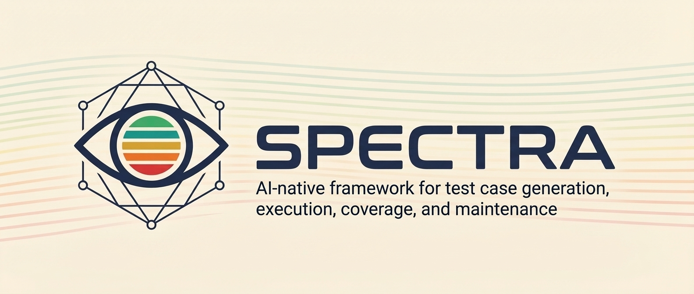

<!-- Banner -->
<p align="center">
  
</p>

<!-- Badges -->
<p align="center">
  <a href="https://www.nuget.org/packages/Spectra.CLI"></a>
  <a href="https://github.com/AutomateThePlanet/Spectra/actions/workflows/ci.yml"></a>
  <a href="LICENSE"></a>
  <a href="https://dotnet.microsoft.com/download"></a>
  <a href="https://automatetheplanet.github.io/Spectra/"></a>
</p>

<p align="center">
  📖 <strong>Browse the full documentation at <a href="https://automatetheplanet.github.io/Spectra/">automatetheplanet.github.io/Spectra</a></strong>
</p>

<!-- Tagline -->
<p align="center">
  <strong>AI-native test case generation and execution framework.</strong><br>
  From documentation to deterministic test execution.
</p>

---

## What does SPECTRA mean?

The name evokes the **visible spectrum** — SPECTRA covers the full spectrum of test activities, from documentation analysis through generation, verification, execution, coverage, and reporting. Nothing in the workflow is left dark.

It also reads as a backronym:

> **S**pec-driven · **P**rotocol for · **E**xecutable · **C**overage, · **T**esting, · **R**easoning · and · **A**utomation

In practice it's a single product with two halves that can be used independently:

1. An **AI test-generation CLI** that turns product documentation into versioned Markdown test cases.
2. A **deterministic execution engine** (`spectra run`) that drives those tests through a state machine any assistant or terminal can step through.

## Why SPECTRA?

SPECTRA reads your product documentation, generates comprehensive test suites, keeps them current as the docs change, and executes them through a deterministic protocol. It doesn't replace your existing tools — it adds an AI layer.

- **Reads your documentation** — Point SPECTRA at your product docs and it generates comprehensive test suites automatically.

- **AI with guardrails** — Dual-model grounding verification catches hallucinated test steps before they reach your suite.

- **Test cases as Markdown** — Test cases are plain Markdown files with YAML frontmatter. They live in GitHub, versioned alongside your code.

- **Deterministic execution** — `spectra run` provides a state machine that an assistant (or you, in a terminal) drives without holding state.

- **Coverage visibility** — Three-dimensional coverage analysis: documentation, acceptance criteria, and automation. Visual dashboard included.

- **No migration needed** — Integrates with Azure DevOps, Jira, Teams, Slack through their MCP servers. No data sync. No vendor lock-in.

## Key Features

### AI Test Generation

Generate test cases from product documentation by asking Claude Code — the bundled `spectra-generate` skill runs the
flow in your session: it analyzes your docs, identifies testable behaviors, shows what existing tests already cover,
generates structured test cases batch by batch, and lets you describe undocumented behaviors. SPECTRA itself makes no
model call: every step is a deterministic `spectra ai compile-*` / `ingest-*` command, and the model work happens in
your own Claude Code session.

Behavior analysis applies six **ISTQB test design techniques** systematically (Equivalence Partitioning, Boundary Value Analysis, Decision Table, State Transition, Error Guessing, Use Case) so the produced suites have meaningful boundary and negative coverage instead of happy-path-only scenarios. Analysis output exposes both a category breakdown and a per-technique breakdown.

> "Generate test cases for checkout"
> "Generate 15 test cases for checkout focusing on error handling"
> "Add a test case for a session timeout after 30 minutes"

### Grounding Verification

Every generated or edited test is verified by the `spectra-critic` subagent (on its own model, `ai.critic.model`)
against the source documentation. Hallucinated steps are caught and rejected; partial tests get one repair. The
critic reads only the doc sections each test cites, so verification stays cheap on large documentation sets.

### Keeping Tests Current When Docs Change

When documentation changes, SPECTRA tells you which tests are affected and why — without a model: `spectra ai
update-triage` compares each test's referenced doc sections and criteria with their recorded baseline and groups the
tests by what changed. The `spectra-update` skill then relinks renamed docs, edits the affected tests group by group,
re-verifies them with the critic, and acknowledges the rest. See
[When documentation changes](docs/usage.md#when-documentation-changes) for the whole flow with a worked example.

### Coverage Analysis

Three coverage dimensions tracked automatically:
- **Documentation** — which docs have linked tests
- **Acceptance Criteria** — which criteria are tested
- **Automation** — which tests have automation code

```bash
spectra ai analyze --coverage --auto-link
```

### Visual Dashboard

Static HTML dashboard with suite browser, test viewer, run history, and coverage visualizations.
Deploy to Cloudflare Pages with GitHub OAuth authentication.

```bash
spectra dashboard --output ./site
```

### Execution Engine (`spectra run`)

Execute tests from the CLI with `spectra run` — nothing to configure or host.
Deterministic state machine with pause/resume, durable SQLite state with crash recovery, and three
report formats (JSON, Markdown, HTML). Run state survives process exits (each short-lived command
reconstructs the queue from a durable snapshot), so the agent loop is just commands between turns.

### Claude Code Integration

Bundled skills (`.claude/skills/`) and subagents (`.claude/agents/`) let you use SPECTRA through natural language in
Claude Code. Say "generate test cases for checkout" and the skill runs the CLI commands, reads their JSON, and presents
the results; the heavy reading happens in subagents, so your conversation stays small.

```bash
spectra init                  # Creates the config, folders, 16 skills and 6 subagents
spectra update-skills         # Update skills and agents when the CLI is upgraded (edited files are kept)
```

### Generation Profiles

Customize AI output with natural language profiles — detail level, negative scenario count, domain rules, formatting preferences.

## Quick Start

**Prerequisites:** [.NET 8.0+](https://dotnet.microsoft.com/download)

```bash
# Install
dotnet tool install -g Spectra.CLI

# Initialize (creates config, folders, skills and subagents)
spectra init

# Build the document index
spectra docs index

# Validate test files
spectra validate

# Analyze coverage
spectra ai analyze --coverage

# Generate a visual dashboard
spectra dashboard --output ./site
```

Then open Claude Code in the project and ask:

> "Extract acceptance criteria from my documentation"
> "Generate test cases for checkout"

Generation, criteria extraction, updates and verification need a model, so they run in your Claude Code session (the
skills drive the CLI). Everything else is a plain command.

**For CI** — the deterministic commands support `--output-format json` and `--no-interaction`:

```bash
spectra validate --output-format json --no-interaction
spectra ai update-triage --all-suites --dry-run --output-format json
spectra ai audit-grounding --suite checkout --output-format json
spectra ai analyze --coverage --output-format json
spectra dashboard --output ./site
```

See [Getting Started](docs/getting-started.md) for detailed instructions.

### Using SPECTRA from Claude Code

After `spectra init`, the bundled `spectra-quickstart` skill is a guided onboarding entry point. Open Claude Code in the project and ask:

> "Help me get started"

The assistant walks you through every workflow (test generation, criteria extraction, coverage, dashboard, execution, customization) with copyable example prompts. For an offline reference covering the same workflows, see the auto-generated [`USAGE.md`](USAGE.md) at your project root.

## Architecture

```
docs/                        <- Source documentation
  |
docs/_index/                 <- Document index (manifest + per-suite files, incremental)
  |
spectra CLI                  <- Deterministic: compiles prompts, validates and persists results
  |                            (no model call; the model work runs in your Claude Code session)
Claude Code skills/subagents <- spectra-generate, spectra-criteria, spectra-update, spectra-critic, ...
  |
test-cases/                  <- Markdown test cases + _index.json + _source-baseline.json
  |
spectra run                  <- Deterministic execution state machine (.execution/spectra.db)
  | (as needed)
Azure DevOps / Jira / Teams  <- Bug logging and notifications through their own integrations
```

| Subsystem | Purpose | Independent? |
|-----------|---------|:------------:|
| **Authoring** (`spectra ai …` + skills) | Generate, update, verify and analyze test cases from documentation | Yes |
| **Execution** (`spectra run`) | Execute tests through a deterministic, resumable state machine | Yes |

## Ecosystem

SPECTRA is part of the [Automate The Planet](https://www.automatetheplanet.com/) ecosystem:

| Tool | Purpose |
|------|---------|
| [BELLATRIX](https://bellatrix.solutions) | Test automation framework |
| [Testimize](https://github.com/AutomateThePlanet/Testimize) | Test case optimization (hybrid ABC algorithm) |
| **SPECTRA** | AI test generation and execution protocol |

**BELLATRIX** automates test execution. **Testimize** optimizes test case selection. **SPECTRA** generates and maintains the test cases themselves — closing the loop between documentation and quality assurance.

> **Optional Testimize integration**: SPECTRA ships with the
> [Testimize](https://github.com/AutomateThePlanet/Testimize) library bundled
> as an in-process NuGet dependency (no separate installation needed). When
> enabled, it replaces AI-approximated boundary values with mathematically
> precise ones — exact min-1/min/max/max+1 BVA, security-focused invalid
> patterns (XSS, SQLi), and optimized multi-field pairwise/ABC combinations.
> Disabled by default; set `testimize.enabled` to `true` in
> `spectra.config.json`. See [Testimize Integration](docs/testimize-integration.md).

## Documentation

| Guide | Description |
|-------|-------------|
| [Getting Started](docs/getting-started.md) | Install, prerequisites, first run |
| [CLI Reference](docs/cli-reference.md) | All commands, flags, and options |
| [Configuration](docs/configuration.md) | Full `spectra.config.json` reference |
| [Test Format](docs/test-format.md) | Markdown format, YAML frontmatter, metadata schema |
| [Coverage Analysis](docs/coverage.md) | Documentation, Requirements, and Automation coverage |
| [Generation Profiles](docs/generation-profiles.md) | Customize AI output style and quality |
| [Grounding Verification](docs/grounding-verification.md) | Dual-model critic for hallucination detection |
| [Document Index](docs/document-index.md) | Pre-built doc index for efficient generation |
| [Skills Integration](docs/skills-integration.md) | Claude Code skills and subagents |
| [Usage (Claude Code)](docs/usage.md) | Workflow-by-workflow guide for driving SPECTRA from Claude Code |
| [When documentation changes](docs/usage.md#when-documentation-changes) | Bringing tests up to date after a doc change, end to end |
| [Customization](docs/customization.md) | Every customization knob — config, profiles, prompts, palettes |
| [Testimize Integration](docs/testimize-integration.md) | Optional algorithmic test data optimization (BVA / EP / pairwise / ABC) |
| [Execution Agents](docs/execution-agents.md) | Driving test execution with `spectra run` |
| [Architecture](docs/architecture/overview.md) | System design and key decisions |
| [Development Guide](docs/DEVELOPMENT.md) | Building, testing, and running locally |

## Project Status

SPECTRA is in active development.

- **Phase 1: AI Test Generation CLI** ✓
- **Phase 2: Execution Engine** ✓
- **Phase 3: Dashboard & Coverage Analysis** ✓
- **Phase 4: Test Generation Profiles** ✓
- **Phase 5: Grounding Verification** ✓
- **Phase 6: Integrations and Ecosystem** ← *current*

## Contributing

Contributions are welcome! See [CONTRIBUTING.md](CONTRIBUTING.md) for build instructions, code style guidelines, and the PR process.

## License

Licensed under the **Apache License, Version 2.0**. See [LICENSE](LICENSE) for the full text.

```
Copyright 2024-2026 Automate The Planet Ltd.

Licensed under the Apache License, Version 2.0 (the "License");
you may not use this file except in compliance with the License.
You may obtain a copy of the License at

    http://www.apache.org/licenses/LICENSE-2.0

Unless required by applicable law or agreed to in writing, software
distributed under the License is distributed on an "AS IS" BASIS,
WITHOUT WARRANTIES OR CONDITIONS OF ANY KIND, either express or implied.
See the License for the specific language governing permissions and
limitations under the License.
```
